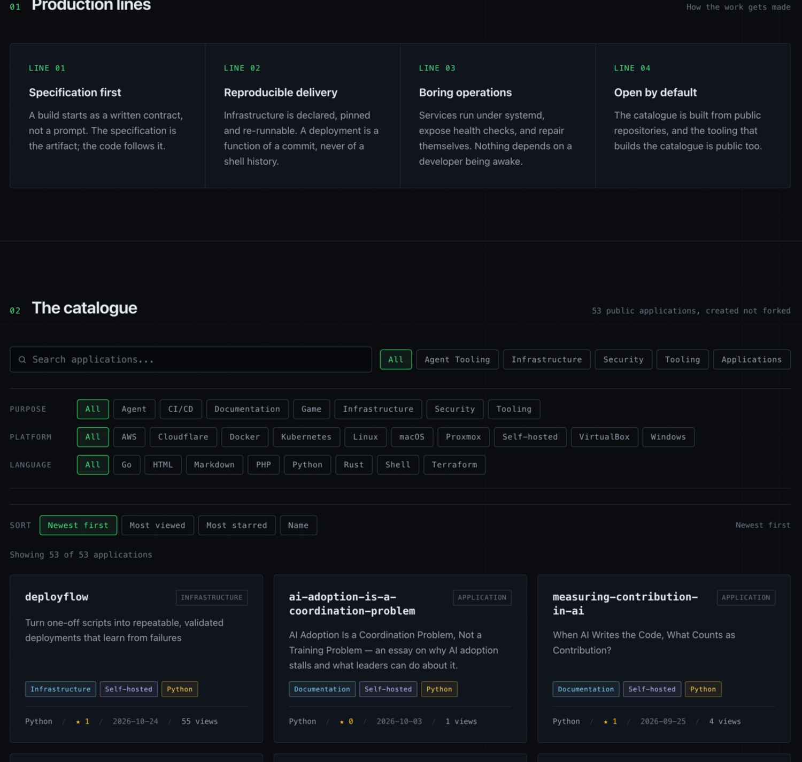

# Repo Showcase

A catalogue page for everything you shipped, set up by asking an agent for it.



*One deployment with 53 repositories. The sample this repository ships has six.*

Every public repository you own is a finished argument that almost nobody can
find. GitHub sorts your profile by last push, and each entry is a name, a
language, and one line of description. Nothing there says what the project
does, what it runs on, or whether it is finished.

Repo Showcase turns the same account into a page that answers those questions:
one card per repository, filters for what it does and where it runs, and four
ways to sort. It is static HTML rendered by [Astro](https://astro.build) and
published to Cloudflare Pages, so there is no server, no database, and no call
to GitHub at runtime. The catalogue is a JSON file you commit, which means every
change to the page arrives as a reviewable diff.

## Why you would use it

| You have | You get |
|---|---|
| Forty repositories and no index of them | One page, filterable by purpose, platform and language |
| A CV that claims breadth | A page that shows it, with links that resolve |
| No appetite for another service to run | Static files on Cloudflare Pages, no server and no database |
| A catalogue that goes stale | `npm run refresh` rewrites the data as a diff you can read |

A domain is optional. Without one the site publishes to
`<projectName>.pages.dev`, which needs no DNS permissions at all.

## Why it is built around an agent

Most site generators ask you to learn their config format. This one asks you to
describe what you want, in a sentence.

| You say | It writes |
|---|---|
| "Drop anything with no stars and fewer than ten files." | `catalogue.unnoticed = { maxStars: 0, maxViews: 0, maxFiles: 10 }` |
| "Sort them by stars." | `sort.default = "stars"` |
| "Point this at my account." | `githubOwner`, and the brand strings that use `{githubOwner}` |
| "Only these repositories belong." | `catalogue.include = [...]` |

The division is deliberate: **judgement belongs in prose, determinism belongs in
scripts**. The agent decides what you meant and writes one key. The scripts read
that key and never guess. No line of code decides which repositories are yours,
which is why the same tree publishes a catalogue of 53 for one account and a
catalogue of one for another without a source change.

Seven skills in `.agents/skills/` carry the procedure, and `site-launch`
sequences the other six. It asks the five questions only you can answer — which
account, what the site is called, which repositories belong, a domain or a
`*.pages.dev` subdomain, and whether to mint a token or paste one — then hands
control back wherever a credential or a browser is needed, and resumes where it
stopped.

Each skill ends by checking its own work. `site-identity` greps the build for
the name you are leaving behind. `catalogue-curate` reports the counts its rules
produced. `site-deploy` fetches the URL and looks for the catalogue before it
says "published". A skill that cannot check itself is a prompt, not a skill.

```
site.config.json        your site: name, brand, account, domains, sort order
catalogue/tags.json     purpose, platform and language for each repository
catalogue/excluded.json what the rules left out, and why
src/data/repos.json     the catalogue snapshot the page renders
.agents/skills/         seven skills that edit the four files above
```

## What you must supply

| You need | Why | Without it |
|---|---|---|
| A GitHub account | The catalogue is built from its public repositories | Nothing to list |
| A Cloudflare account | Cloudflare Pages hosts the site | You can build and preview locally, but not publish |
| Node 22 or later | The build and the scripts | Nothing runs |

## Quickstart

```bash
npm install

# 1. Say who the site is for
$EDITOR site.config.json      # githubOwner, brand.name, projectName

# 2. Pull the catalogue
#    Optional GITHUB_TOKEN raises the rate limit and enables view counts.
GITHUB_TOKEN=$(gh auth token) npm run refresh

# 3. Look at it
npm run dev

# 4. Add .env (see Credentials), then publish
set -a; . ./.env; set +a
npm run cf:setup              # creates the Pages project, mints a deploy token
npm run deploy
```

Steps 1 to 3 need nothing but Node. Step 4 and step 5 are where credentials
enter.

## The skill path

The four data files are meant to be edited by an agent, not by hand. The
skills in `.agents/skills/` read and write them, and each one states how to
check its own work:

| Skill | Trigger it with |
|---|---|
| `site-launch` | "set this up", "publish my repositories" |
| `site-identity` | "rename the site", "point this at my account" |
| `catalogue-curate` | "which repos belong", "drop the empty ones" |
| `catalogue-tag` | "tag my repos", "categorise by purpose" |
| `catalogue-sort` | "sort by stars", "newest first" |
| `catalogue-audit` | "which repos need a README" |
| `site-deploy` | "deploy to Cloudflare", "set up the domain" |

`site-launch` sequences the other six and stops wherever a person has to act:
creating a token in the Cloudflare dashboard, deleting a forwarding rule,
waiting for a certificate, creating a throwaway repository.

Both Claude Code and VS Code read `.agents/skills/` as-is; no plugin is
installed and no config is written.

## Commands

| Command | Does |
|---|---|
| `npm run dev` | Local dev server |
| `npm run build` | Static build to `dist/` |
| `npm run preview` | Serve the build |
| `npm run refresh` | Re-fetch the catalogue from GitHub into `src/data/repos.json` |
| `npm run check:config` | Prove the JavaScript and Python config loaders agree |
| `npm run cf:setup` | One-time: create the Pages project, mint or accept a deploy token |
| `npm run deploy` | Build and publish |
| `npm run compare:sites <a> <b>` | Report how two builds or two live sites differ |

Every script in `scripts/` also accepts `--json` and `--dry-run`, so an agent
can ask what a command would do before it does it.

## The sample catalogue

`src/data/repos.json` ships with six public repositories — Ansible,
Kubernetes, Hugo, Oh My Zsh, mdBook and Composer. They are not the author's
and they are not endorsed by this project: they are there so the page renders
with real content on the first build. `npm run refresh` replaces the file with
your own repositories.

Until you run it, the site says so, in the lede and in the eyebrow.

## Credentials

Nothing secret is committed. `.env` is gitignored; `.env.example` lists every
key and says which step writes it.

| Key | Written by | Used by |
|---|---|---|
| `cloudflare_admin_api_token` | you, by hand, once | `cf:setup` only, and only when minting |
| `CLOUDFLARE_API_TOKEN` | `cf:setup` | `deploy` |
| `CLOUDFLARE_ACCOUNT_ID` | `cf:setup` | both |
| `GITHUB_TOKEN` | you, by hand | `refresh` |

Two ways to get a deploy token, and the README cannot pick for you:

- **Mint one.** Needs an admin token with `Account API Tokens: Write`. Narrower
  at the end, but you have to create a privileged credential first.
- **Paste one.** Create a token with `Cloudflare Pages: Edit` in the dashboard
  and paste it. `cf:setup --no-mint` accepts it and skips the admin token
  entirely.

A pasted token cannot edit DNS. If you asked for a custom domain, `cf:setup`
prints the CNAME each hostname needs and leaves it to you, rather than
pretending to have made it.

## Requirements that are not obvious

- **Cloudflare Pages is deployed by Direct Upload, not by Git integration.**
  The Git integration needs a browser OAuth grant and repository read access,
  and it is a one-way door once chosen.
- **A custom domain needs DNS permission on the exact zone.** `Zone Read` lists
  zones; it does not read or write records. The deploy token is scoped to the
  zone ids the setup step discovered.
- **Page Rules are closed to account-owned API tokens.** If a rule redirects
  your hostname, no API call in this repository can remove it. `cf:setup`
  detects the redirect and stops.
- **`projectName` is both the Pages project and its `*.pages.dev` subdomain.**
  Change it before the first deploy. Renaming later leaves the old project and
  its hostname behind in the account, because nothing deletes what it did not
  create.

## Licence

MIT. See [LICENSE](LICENSE).
